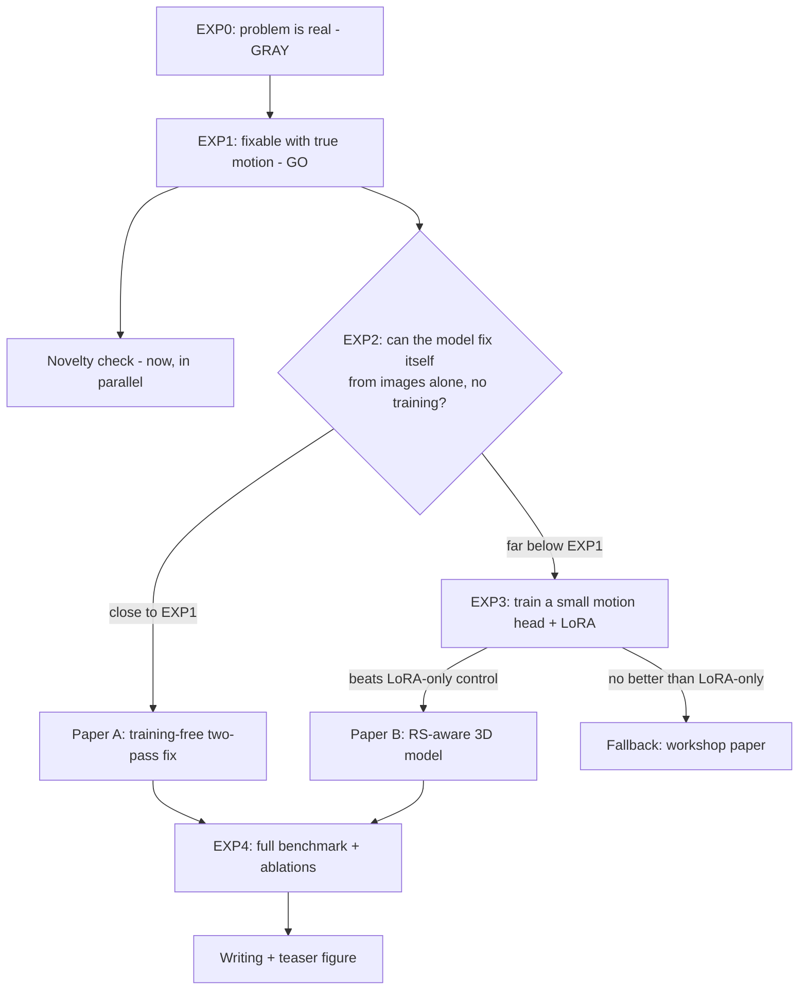

# RS-3D: experiments so far and the road ahead

**Last updated:** 2026-10-28
**Project:** rolling-shutter-native feed-forward 3D (target: CVPR 2027)
**Team:** Dawar, Shubh, Sujal

All numbers are **measured** unless marked *projected*. Detailed write-ups:
- [results/exp0/summary.md](results/exp0/summary.md)
- [results/exp1/summary.md](results/exp1/summary.md)
- [report/EXP0_Rolling_Shutter_Report.pdf](report/EXP0_Rolling_Shutter_Report.pdf)
- [report/RS3D_EXP0_EXP1_Full_Report.pdf](report/RS3D_EXP0_EXP1_Full_Report.pdf): both experiments, every table and figure

---

## TL;DR

1. **The problem is real.** Today's 3D AI models get worse on rolling-shutter photos, up to **2.6×** worse for the best model (π³) when the camera moves fast. *(EXP0)*
2. **The problem is fully fixable in principle.** Straightening the photos with the true camera motion brings accuracy back to normal-camera level:
   - **82–99%** of the extra error goes away when only turning is corrected;
   - **90–100%** goes away when turning and walking are both corrected. *(EXP1)*
3. **The paper must fix it from images alone.** EXP1 used a gyroscope and the true camera path. Gyroscope-based correction very likely already exists in published work (not yet verified).
4. **Next is EXP2.** Can a model work out the motion from its own output and fix itself, with no sensors and no training? The answer decides which paper we write.
5. **Recommended changes to the plan:**
   - use **π³** as the main model;
   - model **both turning and walking**, not only turning;
   - add "gyroscope straightening" as a baseline.

---

## 1. The problem in plain words

Most phone, drone and robot cameras have a **rolling shutter**. They capture a photo row by row, top to bottom, over about 30 ms. If the camera moves during those 30 ms, each row is taken from a slightly different position. The photo comes out slightly bent: walls lean, objects wobble.

3D AI models such as VGGT, π³ and MapAnything assume the whole photo was taken in a single instant. When they get bent photos, they misjudge where the camera was and how the scene is shaped.

**Our idea:** teach these models that each photo is captured over time. The model also predicts how the camera was moving, and uses that to un-bend the geometry inside the model. When the camera is still, nothing changes, so normal photos are unaffected by design.

### Words used in this document

| Word | Meaning |
|---|---|
| **GS** (global shutter) | A normal camera: the whole photo is taken at once. |
| **RS** (rolling shutter) | Row-by-row camera: photos bend when the camera moves. |
| **Path error (ATE)** | How far the model's estimated camera path is from the true path, in cm, after the best-fit alignment. Lower is better. |
| **Turning error (RPE-rot)** | How wrong the model is about how much the camera turned between frames, in degrees. |
| **Unrolling / straightening** | Moving each row of an RS photo to where it would be if the whole photo had been taken at once. |
| **Oracle** | Using information a real system would not have (true motion), to measure the best case. |
| **Gap closed** | How much of the extra RS error goes away. 0% = no help. 100% = back to normal-camera level. |

---

## 2. Setup shared by all experiments

| Item | What we used |
|---|---|
| **Dataset** | TUM RS-VIO (Schubert et al., IROS 2019), described below. |
| **Clips** | 16 frames each, every 3rd frame (2.25 s per clip), a new clip every 8 frames. **1124 clips**: 15 of 1139 were dropped for too little motion or missing true positions. The same clips are used in every experiment. |
| **Models** | MapAnything (Apache weights), VGGT-1B and π³. Photos only: no extra information, no training or fine-tuning. |
| **Speed groups** | Set by the gyroscope's turning speed: • slow: under 0.5 rad/s (under ~29°/s), 56 clips; • medium: 648 clips; • fast: 1.5 rad/s or more (86°/s or more), 420 clips. |
| **Statistics** | Median per group, 95% confidence intervals from 1000 resamples, and a per-clip paired test (Wilcoxon). |
| **Hardware** | Shared rented GPU (80 GB). We worked only in `~/rs3d/` and never touched the other team's experiment. |

The dataset deserves its own description, because it is what makes a fair comparison possible:
- two cameras sit side by side and are triggered at the same moment: cam0 is normal (GS), cam1 is rolling shutter (RS);
- they record the same scene with the same exposure (2 ms);
- the rig also has a gyroscope (200 Hz) and a motion-capture system that gives the true camera path (120 Hz);
- there are 10 indoor sequences at 20 frames/s, 1280×1024, with an RS readout of 30.18 ms.

---

## 3. EXP0: is there a problem? (gap test)

**Question:** Do the models do worse on RS photos than on normal photos of the same moment, and does it get worse with faster motion?

**What we did:**
- Ran all three models on the matching GS and RS clips and compared their path errors.
- **Extra check (not in the plan):** in one recording, *both* cameras ran in normal mode. Running the pipeline on it shows how much of any difference comes from the cameras simply being two different physical cameras.

### Results

How many times worse RS is than GS (path error, median):

| Model | Slow | Medium | Fast [95% CI] | Fast: GS → RS (cm) | Camera-difference check |
|---|---|---|---|---|---|
| MapAnything | 1.14× | 1.06× | **1.16×** [1.13, 1.21] | 9.33 → 10.85 | 1.00× |
| VGGT | 1.73× | 1.69× | **1.47×** [1.32, 1.57] | 6.60 → 9.72 | 1.18× |
| π³ | 1.70× | 2.19× | **2.61×** [2.44, 2.82] | 1.95 → 5.10 | 1.12× |

- **Turning error:** in fast motion it is 1.26× (MapAnything), 1.68× (VGGT) and 1.80× (π³) worse on RS, and it grows with speed for all three models.
- **π³'s penalty grows with speed.** In finer speed bins it goes from **1.6×** for the slowest clips to **3.9×** for the fastest.
- **Camera differences explain at most about 1.1–1.2×**, so the rest is the rolling shutter.

**Verdict: GRAY** (between GO and STOP by the pre-agreed rule).
- MapAnything barely reacts (STOP on its own). It is also the least accurate model to begin with, which may hide the effect.
- VGGT and π³ show a large penalty. But they fail one rule: the slow clips should show almost no penalty (≤ 1.2×), and they show about 1.7×.

**Why the slow clips still showed a penalty, as a hypothesis after EXP0:** "slow" was defined by turning speed only. These clips still contain walking at about **0.6 m/s** and about 7.5 px of rotation bending. So they are not truly free of rolling-shutter effects.

**What EXP0 could not prove:**
- whether the slow-clip penalty is really caused by the rolling shutter;
- whether the penalty can be removed at all.

**Time:** about 1 h 50 min in total, including setup.

---

## 4. EXP1: can it be fixed if we know the motion? (oracle headroom)

**Question:** If we straighten the RS photos with the *true* camera motion, how much of the extra error goes away?
- **Pre-agreed rule:** GO if ≥ 50% of the gap closes in fast motion; STOP if < 25%.

**What we did:**
- **E1a, the planned test:** straighten each RS photo for the camera's **turning**, using the gyroscope.
- **E1b, the extra test we recommended after EXP0:** also straighten for the camera's **walking**.
  - This needs to know how far away things are. We used π³'s depth estimate, scaled to metres with the true path, plus the true walking speed.
- **Re-run:** all three models on the straightened photos, with the same clips and scoring as EXP0.

**Checks, all passed before the run:**
- With zero motion, the straightened photo is identical to the original (0.0 px difference).
- The gyroscope's predicted rotation matches the true rotation to within 0.13°, out of 4.45°. A sign error would show up as 9°.
- On the fastest frame, the straightened RS photo visibly lines up with the normal-camera photo.

### Results

Share of the extra error that goes away (fast clips, path error, 95% CI):

| Model | E1a: turning only | E1b: turning + walking | Fast clips (cm): GS / RS raw / E1a / E1b |
|---|---|---|---|
| MapAnything | **99%** [86, 117] | 117% [106, 136] | 9.33 / 10.85 / 9.35 / 9.07 |
| VGGT | **83%** [71, 97] | 90% [75, 103] | 6.60 / 9.72 / 7.14 / 6.91 |
| π³ | **82%** [79, 85] | 98% [96, 100] | 1.95 / 5.10 / 2.51 / 2.03 |

Slow clips, the open question from EXP0:

| Model | E1a: turning only | E1b: turning + walking |
|---|---|---|
| π³ | 86% | 109% |
| VGGT | 63% | 83% |
| MapAnything | noise: its gap here is only 0.5 cm, with CIs spanning zero | noise |

**Verdict: GO** for all three models, in both versions.

What we learned:
1. **The rolling shutter is the whole cause.** Once the photos are straightened, accuracy returns to normal-camera level at every speed.
2. **EXP0's slow-clip puzzle is solved.** The slow-clip penalty was also rolling shutter, mostly from walking.
3. **Turning does most of the damage, and walking matters too.**
   - Correcting walking adds **15–20 points**: π³ fast goes from 82% to 98%, VGGT slow from 63% to 83%.
   - So our method should model both.
4. **π³ is the best model to build on.** It has the biggest and clearest effect: 2.6× penalty, and a tight CI of [79, 85].
5. **Values above 100% are noise, not "better than a normal camera".** They are within the camera-difference check from EXP0.

**What EXP1 does not prove:**
- **It doesn't show the fix is possible without a gyroscope.** E1a used a real gyroscope, and E1b used the true path and depth scale.
- **It doesn't show the result generalizes.** Everything so far is one room, one camera rig and one readout time (30 ms).

**Time:** 2 h 02 min. The extra error was removed on 9,248 photos per version.

---

## 5. Where we stand

| We now know (measured) | We don't know yet |
|---|---|
| RS hurts VGGT and π³ a lot, and MapAnything a little. | Can a model estimate the motion from images well enough to fix itself? **(EXP2)** |
| The damage grows with speed (π³: 1.6× → 3.9×). | Does a trained "motion head" beat simple fixes? **(EXP3)** |
| It is caused by the rolling shutter, not by camera differences (those are ≤ 1.2×). | Does it work on other cameras, phones and outdoor scenes? |
| Knowing the motion removes 82–100% of the damage. | Has someone already published this exact idea? **(novelty check)** |
| Both turning and walking matter. | |

---

## 6. The road ahead

**Deadline** (from the project brief; verify on the CVPR site): CVPR 2027 registration ~Nov 10, submission ~Nov 16, 2026. That leaves **~13 days to registration and ~19 days to submission**. It is tight but workable, because each experiment so far took about 2 hours.

### Step 1: novelty and prior-work check (now, in parallel with EXP2)

**What:**
- Search recent arXiv (last 60 days) and the main venues for "rolling shutter + feed-forward 3D".
- Also search for: gyroscope-based RS correction, SMARSC (CVPR 2019), and RS unrolling networks.

**Why:**
- **Scoop risk is real.** The same kind of adapter for fisheye lenses has already been published (RayTun3R, Fisheye3R), so rolling shutter is the obvious next target.
- **Reviewers will ask "why not just use the gyroscope?"** EXP1 shows that works, so we need to know exactly what is already published.

### Step 2: EXP2, the cheap training-free fix (next experiment, *projected* ~3–5 h including coding)

**What:**
1. Run the model once on the raw RS clip.
2. From its own output, estimate how the camera was turning and moving: compare neighbouring frames' poses, divided by the time between them.
3. Straighten the photos with that estimate.
4. Run the model again.
5. Compare against EXP1's numbers, which are the best case.

**Why it's next:**
- **It decides which paper we write.** If it gets close to EXP1, we have a simple training-free paper. If not, a trained motion head is justified.
- **It is the "no gyroscope" test.** That is exactly the reviewer question from Step 1.
- **It costs almost nothing.** EXP1's code is reused, and the result becomes a required baseline in the final paper anyway.

**Design notes:**
- **Walking can be estimated without knowing true scale.** The bend from walking depends on *speed ÷ distance to the object*. The model gives both in the same unknown units, so the units cancel. That means EXP2 can correct walking too, with no true scale needed.
- **Each model uses its own depth.** In E1b all three models borrowed π³'s depth.
- **Agree the decision line before running.** Proposed, for the team to confirm:
  - "close to EXP1" = EXP2 closes **≥ 70%** of what the oracle closes in fast clips;
  - "far below" = **< 40%**;
  - in between = do both: report EXP2 as a strong baseline and go to EXP3.
- **Expected difficulty:** neighbouring frames in a clip are 150 ms apart while the readout is 30 ms, and the first-pass poses are themselves bent. So the estimate will be rougher than the gyroscope. EXP2 measures how much that matters.

### Step 3: depends on EXP2

- **If EXP2 is close to EXP1 → Paper A (training-free):** "two passes fix rolling shutter in any 3D foundation model".
  - Polish it, try a third pass, and test on more models.
  - It is cheaper and lower-risk, and still publishable.
- **If EXP2 falls well short → EXP3 (*projected* ~4–6 h for the first run, plus building the data generator):**
  - Build a generator that makes synthetic RS videos from datasets that have depth and camera paths (ScanNet++, TartanAir).
  - Train a small "motion head" plus a light adapter (LoRA) that predicts **turning and walking** per photo and un-bends the geometry inside the model.
  - **GO** only if it clearly beats the same adapter trained *without* the motion head, and does not hurt normal photos.

### Step 4: full benchmark (remaining time)

**Compare:**
1. the plain model;
2. "straighten the photo first, then reconstruct" (an existing unrolling network);
3. gyroscope straightening (this is E1a, already done);
4. EXP2;
5. adapter only;
6. ours.

**Measure:**
- path error on TUM RS-VIO;
- 3D shape quality on synthetic RS (as far as we know, TUM RS-VIO has camera paths only, no 3D ground truth);
- no loss of quality on normal photos.

### Recommended changes to the original plan, and why

| Change | Why (evidence) |
|---|---|
| **Main model π³, then VGGT; MapAnything secondary** (the plan had MapAnything first) | π³ has the largest gap (2.6×) and the cleanest results. MapAnything's gap is so small that any gain is hard to show. |
| **Predict both turning and walking**, regularized (the plan said "focus on turning") | E1b: walking adds 15–20 points, and it explains the slow-clip penalty. |
| **Add gyroscope straightening as a baseline** | E1a shows it works very well. Reviewers will ask for it, and we already have the numbers. |
| **Speed up the pipeline before EXP2** | Most run time was CPU work (straightening, photo loading), not the GPU. *Projected (rough guess, untested):* caching resized photos and straightening on the GPU could cut run time by half or more. |

---

## 7. Risks

| Risk | How likely | What we do |
|---|---|---|
| Someone publishes the same idea first | Medium (fisheye versions are already out) | Re-search arXiv weekly. Move fast. A workshop paper is the fallback. |
| "Just use a gyroscope" | High as a reviewer question | Images-only is our angle. Include the gyroscope baseline, and stress videos that have no sensor data (internet, drones, old footage). |
| The model's own motion estimate is too rough | Unknown | That is exactly what EXP2 tests. If it is too rough, a learned motion head is the paper (EXP3). |
| One dataset only | Certain right now | Add synthetic RS with different readout times. Try a second real RS dataset if one exists. |
| Walking speed is hard to estimate | Medium | Regularize toward zero, and report turning-only and turning+walking separately. |
| Deadline | Tight (~19 days) | Each step has a GO/STOP rule. The workshop track is the fallback. |

---

## 8. Files, reproduction and housekeeping

**Code** (in `src/`, also on the VM at `~/rs3d/src/`):

| Script | What it does |
|---|---|
| `common.py` | paths, timing constants, true-path lookup, scoring |
| `prep.py` | photo preparation and clip building |
| `infer.py` | runs a model on clips |
| `evaluate.py` | EXP0 analysis |
| `unroll.py` | photo straightening: `rot`, `rotrans`, `check` |
| `pi3_depth.py` | depth for E1b |
| `run_e1.sh` | the full EXP1 pipeline |
| `evaluate_e1.py` | EXP1 analysis |

**Results:**
- `results/exp0/`: summary, data notes, tables and plots.
- `results/exp1/`: summary, tables and plots.

**Housekeeping:**
- **Only on the VM:**
  - EXP1's raw model outputs (`~/rs3d/results/exp0/preds/*_e1*.npz`, ~2 MB each). The per-clip scores are already copied locally in `results/exp1/per_window_e1.csv`, so nothing needed for the write-up is lost.
  - The straightened photos and depth maps (~2 h to regenerate).
- **The new EXP1 code and results are not committed to git yet.** That covers `src/unroll.py`, `pi3_depth.py`, `run_e1.sh`, `evaluate_e1.py`, the `infer.py` change and `results/exp1/`.
- **A leftover tmux window `rs3d:setup` on the VM** holds a stuck download. It uses no CPU or GPU. Close it by hand with `tmux kill-window -t rs3d:setup`.
